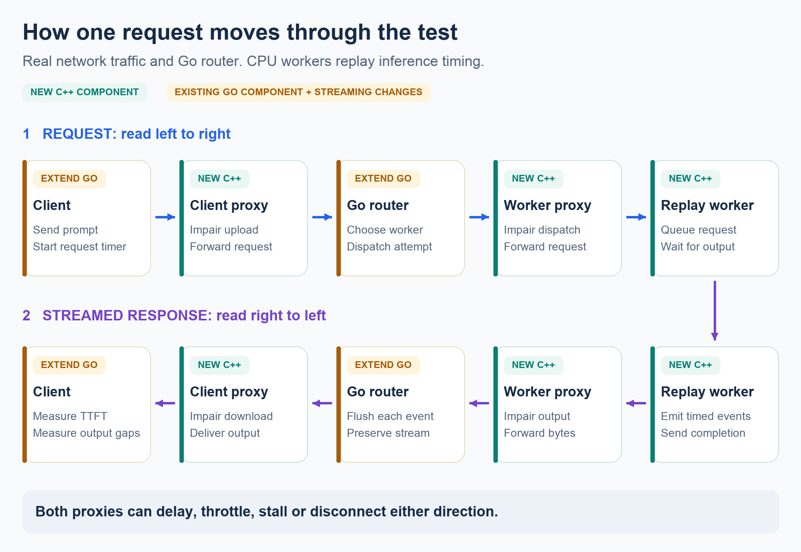

# Network resilience tests

**Problem:** worker-kill tests do not show how slow, stalled or broken client
and worker connections affect streamed inference.

**Solution:** real TCP fault injection around the actual Go router, with a
streaming Go load generator and either timed CPU replay or real inference.
Python starts the processes, applies the fault schedule, saves evidence and
cleans up. No AWS API calls or instance provisioning.

## Run locally

From this checkout, install Go 1.22+, CMake 3.24+, a C++20 compiler and Python
3.10+. The first build fetches checksum-pinned Asio/nlohmann headers and the
router's existing Go modules. Torch, CUDA and Docker are not required.

```sh
PYTHONPATH=src python -m orchestrator fleet net-test
# Optional installed command, without pulling training/ML dependencies:
python -m pip install --no-deps -e .
spot-orchestrate fleet net-test
```

JSON configs use Python's standard library. YAML additionally requires
`python -m pip install PyYAML`. Run `net-test --help` for the small CLI surface:

```sh
spot-orchestrate fleet net-test --config experiments/network/quick.json
spot-orchestrate fleet net-test --scenario worker-stall
spot-orchestrate fleet net-test --config my-test.json --dry-run
spot-orchestrate fleet net-test --build  # rebuild after source changes
```

The default starts three replay workers, two proxy roles, the router and one
continuous load generator. It verifies a complete streamed request before
measurement. It offers **6 requests/s** for **30s healthy → 30s worker-1 response
delay (+300ms) → 60s after removal**. Requests use the same workload throughout.
No automatic calibration changes the declared rate or budgets.

### Reproduce the complete scenario report

From the repository root, run:

```sh
PYTHONPATH=src python -m orchestrator.nettest.suite
```

This builds once, freezes copies of all three executables and the profile, then
runs all **14 presets sequentially** with fresh processes. The pinned
`experiments/network/report.json` recipe keeps the current three-worker,
6 RPS, 30/30/60s workload and unchanged acceptance criteria. Seed is 42;
scenario order is fixed. Allow **about 28 minutes plus compilation**. No GPU,
model download, Docker or cloud access is needed for this command.

Read `.fleet/network-report/report.md`. The same folder contains machine-readable
`summary.json`, SHA-256/source/platform records in `suite.json`, per-scenario
logs and raw evidence, and a portable `evidence.tar.gz` (without binaries or
weights). The report is updated after each scenario. Ctrl-C retains a partial
report; unexecuted scenarios are explicitly NOT RUN.

**A failed scenario does not stop the suite.** Exit 0 means all scenarios passed;
1 means at least one valid run failed its SLO contract; 2 means invalid/incomplete
evidence or execution; 130 means interrupted. Severe failures are expected to
miss the default availability contract. The runner never relaxes thresholds.
Use a new `--output` directory for another run; existing evidence is not replaced.

```sh
# One preset, using the same pinned recipe and seed:
PYTHONPATH=src python -m orchestrator.nettest.suite \
  --scenarios worker-stall --output .fleet/worker-stall-report

# Offline: rebuild the recorded report, without traffic or compilation.
mkdir -p .fleet/recorded-network-report
tar -xzf experiments/network/results/evidence.tar.gz -C .fleet/recorded-network-report
PYTHONPATH=src python -m orchestrator.nettest.suite \
  --report-from .fleet/recorded-network-report
```

Offline regeneration verifies input/case checksums and recomputes metrics from
the saved request and attempt JSONL, using the recorded phase windows. It must
agree with the original reports before replacing the combined report. With
the same source/Python, repeated regeneration yields identical Markdown, JSON
and archive bytes. Changed evidence is rejected. The bundle's per-case
`report.txt` files show every acceptance check and its actual value/limit.

**Fresh live runs are not bitwise deterministic:** OS scheduling, TCP chunking
and buffering affect timings, including seeded jitter applied to chunks. Fixed
inputs make the experiment repeatable, not its wall-clock samples identical.
Each preset is one run, not a confidence interval or a natural failure-rate
estimate. Keep the machine otherwise quiet and compare distributions/verdicts.

The runtime uses unique run directories and owned process groups. Ctrl-C,
startup failure and normal completion clean up owned processes. A proxy rule
expires independently; process lifetime is bounded. An existing model server
is never stopped by the harness.

## Request path and implementation



This diagram shows replay mode. A real CPU/GPU model server replaces the replay
endpoint while the surrounding path stays the same. Multiple proxy listeners
can share one C++ process; each worker remains individually targetable.

| Component | Implementation |
|---|---|
| C++ proxy | Asio socket/timer event loop, independent request/response queues, 256KiB queue bound per direction. Delay/jitter preserve byte order; stall pauses and applies backpressure; rate caps pace bytes; cutoff closes after N forwarded bytes. |
| C++ replay worker | Exact timing-shape lookup, bounded queue/active requests, independent output-production timers and socket writes, synthetic SSE events and completion marker. No interpolation for unsupported shapes. |
| Go router | New streaming branch forwards and flushes SSE, retries transport/5xx before output commitment, forwards 4xx, never retries a committed stream. Non-streaming behavior remains supported. |
| Go load generator | Open-loop arrivals, bounded concurrency, parsed SSE events, explicit incomplete/canceled/drop outcomes, per-request monotonic timings. End-to-end timing includes body consumption. |
| Python | Resolve config, build/launch/readiness, schedule expiring rules through loopback management HTTP, collect evidence and evaluate frozen thresholds. |

The runner writes listener/upstream mappings, registers **proxy** worker
addresses, and points the client at the client-link proxy. Proxies start with
normal forwarding. Runtime rules name a listener, direction, action and TTL;
updates affect matching active connections and new connections. One active rule
per target/direction is allowed; overlapping rules are rejected. Disable stops
new connections but preserves existing ones. This differs from Toxiproxy's
proxy disable, which closes existing connections too.

Registry documents remain live for the bounded experiment independently of
serving faults. They are test-controlled registration fixtures, not a test of
S3 heartbeat reliability. Management traffic bypasses serving fault rules.

## Backends and timing provenance

### Replay (default)

The default `netfault/profiles/h100-llama31-8b.json` is a prepared export from
NVIDIA AIConfigurator 0.12.0: H100 SXM, Llama 3.1 8B, vLLM 0.24.0, batch=TP=PP=1,
512 input / 16 output tokens. The SDK predicts about 12.02ms to first output and
6.17ms per subsequent output. These are **model-derived estimates**, not measured
GPU request timings. The shipped file records model/backend settings, compiled
engine checksum, performance-data hashes and per-prediction provenance. Default
runs need neither the SDK nor a GPU.

`netfault/profiles/synthetic.json` is deliberately labeled **synthetic**:
100ms to first output, then fifteen 20ms gaps. Each synthetic output event
contains one `x`. This makes CI and fault behavior reproducible without claiming
GPU accuracy. `replay_input_tokens` is a shape selector, not tokenization of the
text prompt. One active request per worker and the declared FIFO queue are
surrogate behavior, not continuous batching or a KV-cache model.

The JSON timing format contains `kind`, provenance metadata, and exact samples:

```json
{"kind":"model-derived","samples":[
  {"input_tokens":512,"output_tokens":3,"first_output_ms":12,"gaps_ms":[5,5.1]}
]}
```

Those numbers illustrate the schema only. Profiles must have finite, bounded
timings and exactly `output_tokens - 1` gaps. Unknown shapes fail explicitly.

### H100-derived schedules: one CPU preparation step

The optional exporter reuses NVIDIA AIConfigurator's `EngineHandle`; it does
not invent/reimplement an estimator. Install AIC in a **separate Python 3.11–3.13
preparation environment**, then export a compatible model/system/backend tuple:

```sh
python -m pip install aiconfigurator==0.12.0
PYTHONPATH=src python -m orchestrator.nettest.profile \
  --system h100_sxm --model meta-llama/Meta-Llama-3.1-8B \
  --backend vllm --backend-version 0.24.0 \
  --input-tokens 512 --output-tokens 16 --output .fleet/h100-8b.json
```

Set `profile: .fleet/h100-8b.json` in the experiment file. Preparation uses
previously measured performance data and CPU prediction, not a GPU. Runtime
replay only reads the exported file. The exporter records SDK/backend versions,
model/system/batch/parallelism, units and engine-spec checksum. The exporter hashes the installed performance database. Supply
`--systems-path` to use a different complete pinned AIC database. Partial attention/GEMM tables alone are not a complete database.

Pacing is **model-derived**, batch=TP=PP=1, without prefix reuse. Missing SDK/data,
unsupported shapes or invalid estimates fail without synthetic substitution.
This is not a recorded per-token trace, hardware validation, natural network
failure distribution or a prediction of saturated fleet capacity.

### Small real CPU model

Use native llama.cpp and one **Qwen2.5-0.5B-Instruct Q4_K_M GGUF**. The official
file is **491,400,032 bytes** (~491MB). Allow roughly 1GB disk for one model plus
minimal native binaries, and an estimated 1–2GB RAM with a short context;
package dependencies can increase this. Download one file, not the model repo.

[Official pinned model file](https://huggingface.co/Qwen/Qwen2.5-0.5B-Instruct-GGUF/blob/9217f5db79a29953eb74d5343926648285ec7e67/qwen2.5-0.5b-instruct-q4_k_m.gguf)
SHA-256: `74a4da8c9fdbcd15bd1f6d01d621410d31c6fc00986f5eb687824e7b93d7a9db`.

```sh
# Edit model_file (absolute path) and llama_server in the example first.
spot-orchestrate fleet net-test --config experiments/network/cpu-model.yaml
```

No weights are downloaded implicitly. This preset uses one worker, one server
slot, two CPU threads, 512 context tokens and GPU/device/operation offload explicitly disabled. It has its own
CPU budgets and low offered rate. Small sample counts provide functional
coverage, not a statistically strong p99/availability claim. Real-model SSE
events may contain multiple tokens: report **inter-output gaps**, not guessed
per-token latency. Model mode bypasses the timing estimator entirely.

### Existing real GPU server

Start the model server yourself and edit
`experiments/network/external-gpu.yaml`: endpoints are reachable `host:port`
addresses, plus model ID, worker count, workload and appropriate SLOs. The runner
starts its own proxies/router/client and attaches to those endpoints. An API
adapter is needed for servers that do not implement streaming `/v1/completions`.
The current external mode uses plain HTTP on a trusted test network; it does
not implement TLS termination or per-worker authentication. No implicit GPU
model download, GPU provisioning or remote server shutdown.

## Fault presets

All target/direction/action/timing settings are engineering stress settings,
not estimates of provider failure likelihood. Fault expiry is 1–300,000ms.

| Preset | Action |
|---|---|
| `baseline` | No injected impairment; `direct: true` bypasses both proxies for a separate reference run. |
| `worker-delay` / `client-delay` | Add 300ms on worker-1 responses / 100ms on client responses. |
| `client-jitter` | Seeded 0–150ms client-response variation, preserving byte order. |
| `slow-client-download` / `slow-client-upload` | Response / request byte-rate cap; configure it relative to actual payload size. |
| `worker-stall` | Pause worker-1 responses, including matching active streams. |
| `worker-truncate` | Close after 1,024 response bytes, including headers. |
| `worker-unreachable` | Disable worker-1 listener for new connections; leave active streams intact. |
| `idle-expiry` | Close worker-1 flows after 50ms inactivity in the response direction. |
| `client-disconnect` | Client closes after five nonempty output events for requests dispatched during the fault window. |
| `worker-flapping` | Alternate a worker's response stall and normal forwarding in two-second intervals. |
| `fleet-stall` | Stall every worker's response direction. |
| `combined-path-delay` | Add 100ms on client and worker response hops. |

A custom `fault` object overrides preset target/direction/action fields. For
example `direction: request` tests delayed dispatch/upload. Constant delay shifts
the stream rather than adding the delay between every token. A bandwidth cap
only matters below the stream's actual byte rate. Stalls hold bytes with bounded
backpressure, not silent byte loss. These are byte-stream faults; use Linux
`tc/netem` separately for actual packet loss/reordering/retransmission tests.
To test a stall mid-response, choose a longer output schedule and an activation
time overlapping that worker's stream; a wall-clock rule alone does not guarantee
the request has emitted its first output. `worker-truncate` cuts a response after
the configured byte count, independent of timing.

Presets can legitimately **FAIL** the default availability/SLO contract. Choose
scenario-specific acceptance criteria before running; an all-worker outage is
not automatically considered acceptable merely because it was intentional.

## Metrics and acceptance

Normal per-request SLO: **complete + TTFT ≤250ms + every output gap ≤100ms +
total ≤2s** in the replay default. Completion requires `[DONE]`, valid event
JSON and no read failure. Headers/heartbeats do not establish TTFT. Every offered
request, including generator drops and interrupted streams, remains accounted.

| Check | Healthy | During default worker delay | After removal |
|---|---|---|---|
| Completion | ≥99% | ≥99% | ≥99% |
| Normal-SLO compliance | ≥99% | ≥65%, drop ≤35 percentage points | ≥99% |
| SLO goodput | Reference | ≥65% of healthy | ≥95% of healthy |
| TTFT p95 | Per-request SLO checked | ≤600ms and ≤350ms above healthy | ≤110% of healthy |
| Output-gap p99 | Per-request SLO checked | ≤50ms and ≤125% of healthy | ≤110% of healthy |
| Recovery window | — | — | Starts within 5s, holds 5s, ≥20 requests |

The two-thirds fault allowance explicitly tolerates one of three equally
selected workers missing the normal TTFT target. It is not a claim of 99%
availability. A user requiring ≥99% during the same fault will see **FAIL**.
Additional checks bound attempts, forbid retries after output commitment,
require no generator drops, and check request deadline overruns.

The healthy reference ends one request deadline +100ms before fault activation,
so requests already in flight cannot pollute it. Guard/control-transition
requests remain in a separate group and overall totals. Fault and post-removal
cohorts use actual dispatch times; slow/interrupted requests are retained.
Control send/ack bounds and client/controller clock uncertainty are recorded.
Cross-host timestamps do not establish precise one-way network latency.

Latency/goodput changes use percent; rates use percentage points. Percentiles
are nearest-rank, with sample counts and conditional populations visible. The
recovery window is a retrospective qualification interval; its start and later
confirmation differ. Insufficient samples fail the required check explicitly.

Reports use PASS/FAIL/INVALID labels, optional color (`--color auto|always|never`,
`NO_COLOR`), and ANSI-free saved text/JSON. Exit **0** means valid/all required
checks passed; **1** means valid but criteria failed; **2** means invalid setup,
injection/evidence or execution. SLO failure is never changed into a passing
latency percentile by discarding failed requests.

Evidence under `.fleet/net-tests/<run>/`: resolved config and manifest, binary/
profile hashes, topology, actual phase-control bounds, `requests.jsonl`,
`attempts.jsonl`, proxy/worker events, process logs and `report.json`/`report.txt`.

## Existing EC2/Linux hosts

No instance creation or AWS credentials are needed by the runner. Prepare a
Linux package for the supplied host architecture, then edit the **same**
experiment config's `hosts:` and `artifacts:` fields:

```sh
scripts/package-nettest.sh linux/amd64  # or linux/arm64; Docker needed only for packaging
spot-orchestrate fleet net-test --config experiments/network/ec2.yaml
```

Supported packaging target: Ubuntu 24.04 with Python 3.12+, matching architecture,
SSH access through user-configured aliases and verified host keys. The runner
copies/checksums the package, checks platform/executable readiness, starts owned
processes through a leased SSH agent, collects results and cleans up. Optional
`ssh_config` per host supplies an explicit SSH config file. Management can use
an SSH jump host; data traffic is native TCP over the configured IPv4 addresses.

Place client on A, client-link proxy/router on B, and worker proxies/workers on C.
The EC2 example pins serving/backend/control ports. Permit TCP 18080 from A to B,
and TCP 19001/19003/19005 from B to C. Router/backend/control listeners otherwise
remain private to their host; control uses SSH. Security groups should restrict
sources to the test hosts. Local mode chooses unused ports by default; all
resolved endpoints are saved in the manifest. Do not expose
management listeners: they bind loopback and are controlled through the agent.
Private hosts need staged artifacts or outbound access for first-time downloads.

Three processes on one worker host do not reproduce three independent machine
failures. Add real endpoints/host placements when that distinction matters.
Local loopback exercises real TCP without the VPC path; EC2 has its own healthy
baseline. Compare direct, fault-free proxy and fault runs **within each
environment**. Injected delay adds to existing transport latency; do not add an
assumed RTT to every output event or subtract component percentiles.

For a cross-host `direct: true` replay baseline, also permit the configured backend
ports from router to workers and the router port from client to router. Direct
external endpoints must be reachable from the router, too. The default proxy
experiment only needs the narrower data-port rules above.

**EC2 deployment and real-GPU validation are not performed by this change's
local tests.** Linux packaging/SSH tests establish mechanics, not AWS networking
or hardware fidelity. See the [verification record](network-testing-validation.md)
for actually executed checks, including failed acceptance contracts.

## Verification

```sh
cmake -S netfault -B .fleet/netfault-build -DNETFAULT_SANITIZERS=ON
cmake --build .fleet/netfault-build --parallel 4
ctest --test-dir .fleet/netfault-build --output-on-failure
go -C router-go test -race -timeout 60s ./...
go -C loadgen test -race -timeout 60s ./...
# Build all binaries first; missing binaries make socket/E2E tests skip visibly.
PYTHONPATH=src python -m orchestrator fleet net-test --build-only
PYTHONPATH=src NETFAULT_BINARY=.fleet/netfault-build/optitrain-netfault \
  python -m pytest tests/nettest -q
```

`--build-only` prepares all three local executables without starting traffic.
`--dry-run` only validates and prints settings. The Linux Docker builder is an
alternative for packaging. CI builds all three before tests and saves evidence. The tests cover
transport integrity, bounded fault lifetimes, streaming/retry/cancellation,
exact replay shape selection, controller loss, accounting and explicit negative
SLO results. Timing assertions use tolerances rather than exact sleep equality.

For a local Linux packaging/SSH check (Docker and OpenSSH required):

```sh
docker build -f netfault/Dockerfile --target ssh-test -t optitrain-nettest:ssh .
PYTHONPATH=src python scripts/test-nettest-ssh.py --split-hosts
```

This uses three disposable Linux containers, verifies strict SSH/SCP deployment,
then runs proxied baseline, direct baseline and worker-delay traffic. It checks
native traffic completion and fault impact separately from the printed SLO
verdict; a short smoke can fail the unchanged goodput/latency contract. It does
not provision EC2 or claim to reproduce VPC latency.
